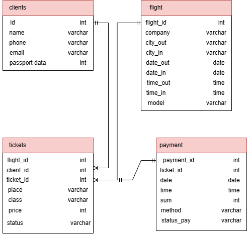

# Анализ и моделирование данных предметной области
## 1. Описание предметной области

Сервис бронирования авиабилетов

Предметная область: бронирование авиаперелётов.

Основные процессы: 
 - ведение информации о рейсах
 - поиск рейса
 - регистрация пассажиров
 - бронирование
 - оформление билетов

Пользователи системы:
 - пассажиры (клиенты)
 - сотрудники сервиса

Основные задачи информационной системы:
 - хранение информации о клинентах и их документах
 - ведение базы данных авиарейсов и маршрутов
 - хранение информации о тарифах и ценах на билеты
 - учет доступных мест на рейсы
 - учет оформленных билетов и бронирований
 - хранение информации о произведенных платежах
 - просмотр истории поездок клиента и статуса его билетов

## 2. Объекты данных

В предметной области выделены следующие основные объекты данных.

### Клиент (пассажир)

Пользователь сервиса, который осуществляет поиск и покупку авиабилетов.

Необходимо хранить:
 - идентификатор клиента
 - ФИО клиента
 - номер телефона
 - адрес электронной почты
 - паспортные данные

### Рейс

Информация о конкретном перелете, выполняемом авиакомпанией по определенному маршруту в заданное время.

Необходимо хранить:
 - номер рейса
 - авиакомпания
 - город вылета
 - город прилета
 - дату и время вылета
 - дату и время прилета
 - модель самолета

### Билет

Конкретное место, забронированное или купленное клиентом на определенный рейс.

Необходимо хранить:
 - идентификатор билета
 - идентификатор клиента
 - номер рейса
 - номер места в салоне
 - класс обслуживания
 - стоимость билета
 - статус билета (забронирован, оплачен, возвращен)

### Платеж

Информация о процессе оплаты авиабилета клиентом.

Необходимо хранить:
 - идентификатор платежа
 - идентификатор билета
 - дату и время оплаты
 - сумму платежа
 - способ оплаты
 - статус платежа

## 3. Атрибуты объектов

Для каждого объекта были определены основные атрибуты и предполагаемые типы данных.

### Клиент

| Атрибут           | Тип    | Описание                          |
|-------------------|--------|-----------------------------------|
| client_id         | Число  | Уникальный иднетификатор клиента  |
| ФИО               | Строка | ФИО клиента                       |
| телефон           | Строка | Номер телефона клиента            |
| почта             | Строка | Электронная почта клиента         |
| паспортные данные | Число  | Электронная почта клиента         |

### Рейс

| Атрибут        | Тип    | Описание                |
|----------------|--------|-------------------------|
| flight_id      | Число  | Уникальный номер рейса  |
| компания       | Строка | Название авиакомпании   |
| город вылета   | Строка | Город вылета            |
| город прилета  | Строка | Гоород прилета          |
| дата вылета    | Дата   | Дата вылета             |
| дата  прилета  | Дата   | Дата прилета            |
| время вылета   | Время  | Время вылета            |
| время  прилета | Время  | Время прилета           |
| модель         | Строка | Модель самолета         |

### Билет

| Атрибут    | Тип    | Описание                                       |
|------------|--------|------------------------------------------------|
| client_id  | Число  | Уникальный идентификатор клиента               |
| flight_id  | Число  | Уникальный номер рейса                         |
| ticket_id  | Число  | Уникальный идентификатор билета                |
| место      | Строка | Номер места в салоне                           |
| класс      | Строка | Класс обслуживания                             |
| цена       | Число  | Стоимость билета                               |
| статус     | Строка | Статус билета (забронирован,оплачен,возвращен) |

### Платеж

| Атрибут        | Тип    | Описание                          |
|----------------|--------|-----------------------------------|
| payment_id     | Число  | Уникальный идентификатор платежа  |
| ticket_id      | Число  | Уникальный идентификатор билета   |
| дата           | Дата   | Дата платежа                      |
| время          | Время  | Время платежа                     |
| сумма          | Число  | Стоимость билета                  |
| способ         | Строка | Способ оплаты                     |
| статус платежа | Строка | Статус платежа                    |

## 4. Классификация данных

Выделенные данные можно классифицировать по их назначению и типу.

| Категория данных | Примеры                                                                                                                                 | Назначение                                       |
|------------------|-----------------------------------------------------------------------------------------------------------------------------------------|-------------------------------------------------|
| Текстовые        | имя клиента, телефон, почта, авиакомпания, названия городов, модель самолета, способ оплаты, статусы платежа и билета, место в самолете | Хранение текстовой информации об объектах                           |
| Числовые         | идентификаторы, цены                                                                                                                    | Хранение числовых значений                                         |
| Даты и время     | даты и время оплат, поездок                                                                                                             | Хранение информации о датах событий                                    |
| Логические       | отсутствуют в модели                                                                                                                    | В текущей модели данные типа «да/нет» не используются                    |
| Справочные       | отсутствуют                                                                                                                             | Хранение перечня доступных услуг                                  |
| Вычисляемые      | отсутствуют                                                                                                                             | Значение может быть рассчитано на основе стоимости выполненных услуг |

## 5. Связи между объектами

Между объектами предметной области были определены следующие связи.

### Клиент – Билет
Тип связи: один ко многим (1:N).

Один клиент может приобрести несколько билетов (на разные рейсы или для разных пассажиров). Каждый билет оформляется на одного конкретного клиента.

### Рейс – Билет
Тип связи: один ко многим (1:N).

Один рейс может содержать множество проданных билетов. Каждый билет всегда привязан к одному конкретному рейсу.

### Билет – Платеж
Тип связи: один к одному (1:1).

По каждому билету производится одна транзакция оплаты. Каждый платеж относится к одному конкретному билету.

## 6. Концептуальная моделль данных

На схеме отражены следующие связи:
 - Клиент 1:N Билет
 - Рейс 1:N Билет;
 - Билет 1:1 Платеж

### Схема концептулаьной модели

## 7. Оценка качества исходных данных

После построения концептуальной модели была выполнена оценка полноты и качества данных.

### Достаточно ли объектов выделено?

Да. Выделенные объекты описывают основные данные, необходимые для учета клиентов, рейсов, оформленных билетов и проведенных платежей.

### Отсутствуют ли важные сущности?

Для рассматриваемой модели основных сущностей достаточно. При дальнейшем развитии системы могут быть добавлены сущности «Самолет», «Аэропорт», «Тариф» или «Скидка», а также «Сотрудник».

### Все ли необходимые атрибуты определены?

Для построения концептуальной модели определены основные атрибуты каждого объекта. 

### Имеются ли дублирующиеся данные?

Явного дублирования данных в модели нет. Информация о клиентах, рейсах, билетах и платежах хранится в отдельных объектах и связывается между собой.

### Достаточно ли информации для дальнейшего проектирования информационной системы?

Да. Выделены основные объекты, их атрибуты и связи. Полученная модель может использоваться как основа для дальнейшего проектирования базы данных.

## Вывод

В ходе лабораторной работы была проанализирована предметная область сервиса бронирования авиабилетов. Были выделены основные объекты данных (клиент, рейс, билет, платеж), определены их атрибуты и выполнена классификация данных.

Между объектами были определены связи один ко многим и один к одному. На основе проведенного анализа была построена концептуальная модель данных.

Полученная модель описывает основные процессы бронирования и оплаты авиабилетов и может использоваться как основа для дальнейшего проектирования информационной системы.

